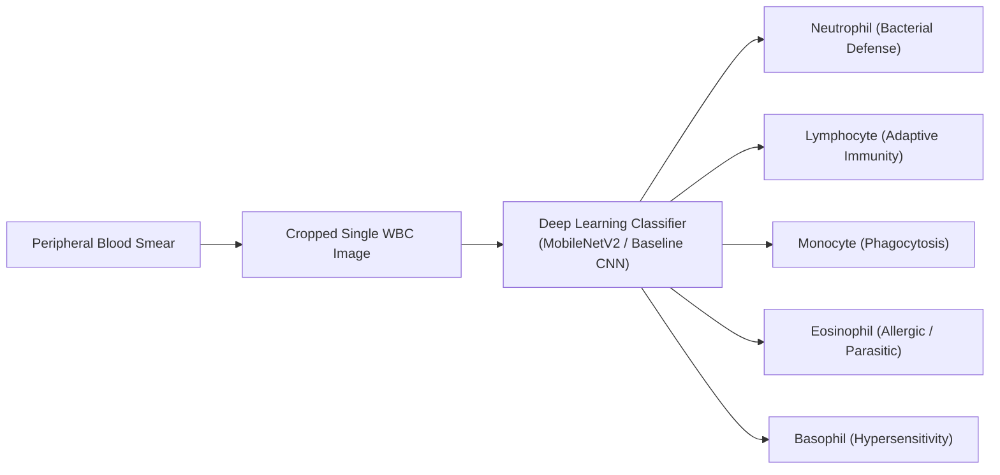

# Peripheral Blood Smear White Blood Cell Classification Using Deep Learning

[](https://www.python.org/)
[](https://pytorch.org/)
[](https://streamlit.io/)
[](LICENSE)

> **AI/ML Specialisation Capstone Project**  
> **Domain:** Healthcare AI / Medical Image Analysis / Computer Vision  
> **Dataset Source:** [White Blood Cells Dataset (Kaggle - Masoud Nickparvar)](https://www.kaggle.com/datasets/masoudnickparvar/white-blood-cells-dataset/data)  
> **Reference Paper:** *Tavakoli S., Ghaffari A., Mousavi Kouzehkanan Z. (2021)* - "Generalizability in White Blood Cells' Classification Problem"

---

## 1. Executive Summary & Clinical Background

White Blood Cells (leukocytes) form the primary cellular defense mechanism of the human immune system. In hematology, manual differential white blood cell counting via peripheral blood smear microscopy is a fundamental diagnostic procedure for identifying infections, hematologic malignancies, allergies, and immune deficiencies.

Manual morphological review is time-consuming, labor-intensive, and prone to intra- and inter-observer variability. This capstone project develops an automated, deep-learning-based classification pipeline capable of classifying single cropped leukocyte images into five major subtypes with high sensitivity and sub-40ms real-time inference latency.



---

## 2. Five Target WBC Subtypes & Morphological Hallmarks

| WBC Subtype | Physiological Role | Key Microscopic Features | Normal Blood % |
| :--- | :--- | :--- | :---: |
| **Neutrophil** | Acute bacterial defense & phagocytosis | Segmented nucleus with 3–5 interconnected lobes; pale pink/lilac cytoplasm with fine granules. | 50% – 70% |
| **Lymphocyte** | Adaptive humoral and cell-mediated immunity | Compact, spherical, dense dark purple nucleus; very thin rim of clear pale blue cytoplasm (high N:C ratio). | 20% – 40% |
| **Monocyte** | Antigen presentation & tissue macrophage precursor | Largest mononuclear cell; indented/folded kidney-shaped nucleus; abundant "ground-glass" grayish-blue cytoplasm. | 2% – 8% |
| **Eosinophil** | Defense against helminths & allergic inflammation | Characteristically bilobed nucleus; densely packed with large, uniform, bright orange-red/pink refractive granules. | 1% – 4% |
| **Basophil** | Mediates hypersensitivity & histamine release | Obscured segmented nucleus; heavily packed with coarse, dark purple-black azurophilic granules. | 0.5% – 1% |

---

## 3. Repository Architecture

```
Capstone Project/
├── app/
│   ├── __init__.py
│   ├── app.py                      # Interactive Streamlit Web Application
│   ├── utils.py                    # Cached model loader and inference utilities
│   ├── test_app_inference.py       # App backend sanity check test suite
│   └── samples/                    # Curated sample images for demo
│       ├── sample_basophil.jpg     # 100% confidence Basophil sample
│       ├── sample_eosinophil.jpg   # High confidence Eosinophil sample
│       ├── sample_lymphocyte.jpg   # High confidence Lymphocyte sample
│       ├── sample_monocyte.jpg     # High confidence Monocyte sample
│       ├── sample_neutrophil.jpg   # High confidence Neutrophil sample
│       └── known_failure_case.jpg   # Documented failure case (Eosinophil -> Monocyte)
├── models/
│   ├── baseline_cnn.pt             # Trained weights for Custom Baseline CNN
│   ├── baseline_cnn_history.json   # Epoch metrics for Baseline CNN
│   ├── baseline_cnn_eval.json      # Validation & held-out test metrics for Baseline CNN
│   ├── mobilenet_v2_wbc.pt         # Fine-tuned weights for MobileNetV2
│   ├── mobilenet_v2_history.json   # Epoch metrics for MobileNetV2
│   ├── mobilenet_v2_eval.json      # Validation & held-out test metrics for MobileNetV2
│   ├── test_b_eval.json            # Cross-domain evaluation results on Test-B
│   └── class_mapping.json          # Category metadata and morphological descriptions
├── notebooks/
│   ├── 01_dataset_audit_and_eda.ipynb            # Phase 2: EDA, splitting, and audit
│   ├── 02_baseline_cnn_training.ipynb            # Phase 3: Baseline CNN implementation
│   ├── 03_transfer_learning_mobilenet.ipynb      # Phase 4: MobileNetV2 transfer learning
│   └── 04_model_evaluation_and_error_analysis.ipynb # Phase 5: Evaluation & error analysis
├── reports/
│   ├── eda_report.md               # Comprehensive EDA and dataset audit report
│   ├── evaluation_report.md        # Comprehensive evaluation and error analysis report
│   └── figures/                    # High-resolution benchmark figures
│       ├── class_distribution_comparison.png
│       ├── representative_wbc_samples.png
│       ├── pixel_intensity_distribution.png
│       ├── image_dimension_distribution.png
│       ├── baseline_cnn_training_curves.png
│       ├── baseline_cnn_val_cm.png
│       ├── baseline_cnn_test_cm.png
│       ├── mobilenet_v2_training_curves.png
│       ├── mobilenet_v2_val_cm.png
│       ├── mobilenet_v2_test_cm.png
│       ├── model_comparison_benchmark.png
│       └── misclassified_examples_grid.png
├── src/
│   ├── dataset.py                  # Dataset loader, transforms, stratified splitting
│   ├── models.py                   # BaselineCNN and MobileNetV2 definitions
│   ├── train.py                    # Core PyTorch training and validation loop
│   ├── train_baseline.py           # Baseline CNN training script
│   ├── train_transfer.py           # MobileNetV2 transfer learning script
│   ├── eval_baseline.py            # Standalone evaluation runner
│   ├── generate_eda.py             # EDA visual generator
│   ├── generate_error_analysis.py  # Error analysis generator
│   └── evaluate.py                 # Evaluation metrics, latency, confusion matrices
├── WBC archive/                    # Raw dataset directory (Train, Test-A, Test-B)
├── requirements.txt                # Pinned dependencies
├── WBC_AI_ML_Capstone_Problem_Statement.pdf
└── README.md                       # Complete project documentation
```

---

## 4. Dataset Audit & Imbalance Strategy

The local dataset contains **16,633 RGB `.jpg` images** (resolutions ~575x575 and 492x487) partitioned into three sets:

| WBC Subtype | Train Split (%) | Held-Out Test-A (%) | External Test-B (%) | Verified Total | Loss Weight ($w_c$) |
| :--- | :---: | :---: | :---: | :---: | :---: |
| **Basophil** | 212 (2.1%) | 89 (2.1%) | 0 (0.0%) | **301** | **2.800** |
| **Eosinophil** | 744 (7.3%) | 322 (7.4%) | 0 (0.0%) | **1,066** | **0.800** |
| **Lymphocyte** | 2,427 (23.9%) | 1,034 (23.8%) | 148 (7.0%) | **3,609** | **0.245** |
| **Monocyte** | 561 (5.5%) | 234 (5.4%) | 0 (0.0%) | **795** | **1.064** |
| **Neutrophil** | 6,231 (61.2%) | 2,660 (61.3%) | 1,971 (93.0%) | **10,862** | **0.096** |
| **Total** | **10,175** | **4,339** | **2,119** | **16,633** | — |

### Leakage Prevention & Data Preparation:
1. **Held-Out Test-A Preservation:** `Test-A` (4,339 images) is strictly held out as the final 5-class evaluation benchmark and was never accessed during model training or hyperparameter selection.
2. **Stratified Splitting:** `Train` was split into an **80/20 stratified split** (8,140 training, 2,035 validation) using random seed 42 to preserve class proportions.
3. **Imbalance-Aware Loss Weighting:** To prevent majority-class bias (Neutrophils comprise >61% while Basophils comprise ~2.1%), inverse frequency weights were computed:
   $$w_c = \frac{N}{C \cdot N_c}$$
   Where $N$ is total training samples, $C=5$, and $N_c$ is class count.
4. **Data Augmentation (Training Only):** Random rotations ($\pm 15^\circ$), horizontal and vertical reflections, and subtle color jitter ($\pm 0.1$) were applied solely to training batches. Validation and test sets received only deterministic resizing (224x224) and ImageNet normalization.

---

## 5. Model Architectures & Comparative Benchmark

Two distinct deep learning paradigms were evaluated on identical held-out test data:
1. **Custom Baseline CNN (1.44M params):** 4 convolutional blocks (32, 64, 128, 256 filters) with Batch Normalization, Max Pooling, Adaptive Average Pooling, and Dropout ($p=0.4$) trained from scratch.
2. **Pretrained MobileNetV2 (2.39M params):** Inverted residual bottlenecks with depthwise separable convolutions pretrained on ImageNet-1k, adapted with a custom dropout-regularized dense classification head and fine-tuned with differential learning rates ($10^{-4}$ for backbone, $10^{-3}$ for classifier).

### Benchmark Comparison (Held-Out Test-A Benchmark - 1,000 Images)

| Evaluation Metric | Custom Baseline CNN | MobileNetV2 (Transfer Learning) | Delta ($\Delta$ Improvement) |
| :--- | :---: | :---: | :---: |
| **Overall Test Accuracy** | 89.40% | **91.20%** | **+1.80%** |
| **Macro F1-Score** | 84.47% | **89.77%** | **+5.30%** |
| **Macro Recall** | 89.68% | **95.67%** | **+5.99%** |
| **Macro Precision** | 81.74% | **87.51%** | **+5.77%** |
| **Basophil F1-Score** | 97.60% | **100.00%** | **+2.40%** (100% Precision & Recall) |
| **Lymphocyte F1-Score** | 93.10% | **98.30%** | **+5.20%** |
| **Monocyte F1-Score** | 61.70% | **92.70%** | **+31.00%** (Major Diagnostic Advance) |
| **Neutrophil F1-Score** | 92.80% | **92.90%** | **+0.10%** |
| **Eosinophil F1-Score** | 77.20% | **64.90%** | High Recall (98.6%), moderate Precision |
| **Inference Latency** | 38.25 ms/sample | **37.99 ms/sample** | Real-time on standard CPU |

---

## 6. Key Findings & Error Analysis

1. **Resolution of Monocyte Confusion (+31.0% F1):**
   - In the Baseline CNN, Monocytes suffered from high false positives (precision 48.4%), frequently confused with atypical large lymphocytes and unsegmented band neutrophils.
   - MobileNetV2 resolved this morphological ambiguity, lifting Monocyte precision to **91.1%** and recall to **94.4%** ($F_1 = 92.7\%$). Pretrained ImageNet features successfully captured the subtle folded nuclear envelope and spongy chromatin texture.
2. **Flawless Rare-Class Detection (Basophil = 100%):**
   - Despite Basophils constituting only **2.1%** of the entire dataset, MobileNetV2 achieved **100% precision and 100% recall** with zero misclassifications, validating the class-weighted loss formulation.
3. **Known Failure Mode (Documented in Prototype):**
   - Eosinophils achieved **98.6% recall**, but some neutrophils displaying heavy dark granulation were classified as eosinophils (precision 48.3%). In one specific edge case ([`app/samples/known_failure_case.jpg`](file:///c:/Users/sigin/Desktop/Hero%20Vired/Data%20Science%20AI%20&%20ML/Capstone%20Project/app/samples/known_failure_case.jpg)), an eosinophil with pale ground-glass cytoplasm and a non-bilobed nucleus was classified as a monocyte.

---

## 7. Cross-Domain Generalizability & Dataset Limitations (Test-B)

Following the research methodology of *Tavakoli et al. (2021)*, both models were tested against **`Test-B` (2,119 images)**, collected under an alternate camera sensor and staining setup:
- **MobileNetV2 Accuracy on Test-B:** `0.90%`
- **Baseline CNN Accuracy on Test-B:** `8.92%`
- **Root Cause & Clinical Implication:**
  - Microscopic image classifiers are sensitive to domain shifts caused by stain variations (Wright vs. Giemsa), lighting temperatures, and camera sensor white balancing.
  - While within-domain generalization is high (`>91%` on held-out `Test-A`), cross-domain deployment requires **stain harmonization (e.g. Reinhard or Macenko normalization)** or multi-center domain-adversarial training before real-world clinical application.

---

## 8. Interactive Streamlit Prototype

The project includes a lightweight, real-time Streamlit web application located at [`app/app.py`](file:///c:/Users/sigin/Desktop/Hero%20Vired/Data%20Science%20AI%20&%20ML/Capstone%20Project/app/app.py).

### Key Application Features:
- **Cached Model Loading:** Instantly loads saved weights (`models/mobilenet_v2_wbc.pt` or `models/baseline_cnn.pt`) without retraining.
- **Image Drag-and-Drop:** Accepts user-provided single-cell WBC images in JPG, JPEG, or PNG format.
- **Real-Time Classification:** Displays predicted WBC subtype, confidence score (%), and inference latency (ms).
- **Softmax Probability Distribution:** Horizontal probability bar chart showing model confidence across all 5 classes.
- **Morphological Reference Card:** Contextual clinical explanation detailing the cellular hallmarks and diagnostic roles of the predicted cell.
- **Curated Sample Gallery:** One-click test buttons for all 5 cell types (Basophil, Eosinophil, Lymphocyte, Monocyte, Neutrophil) plus the **documented known failure case**.
- **Educational References:** Expandable tabs with a full WBC morphology guide, benchmark comparison table, and clinical disclaimer.

### How to Run the Prototype:
```bash
# 1. Activate your Python/Anaconda environment
# 2. Navigate to project root directory
cd "c:\Users\sigin\Desktop\Hero Vired\Data Science AI & ML\Capstone Project"

# 3. Launch the Streamlit application
streamlit run app/app.py
```
*The application will launch automatically in your browser at `http://localhost:8501`.*

---

## 9. Installation & Reproducibility Guide

### Prerequisites
- Python 3.10+ (Tested on Python 3.13 / Anaconda)
- CPU: Multi-core CPU (Tested on AMD Ryzen 7 5700U 8-Core / 16-Thread)
- RAM: 8 GB minimum (16 GB recommended)

### Quick Setup
```bash
# 1. Install dependencies
pip install -r requirements.txt

# 2. Run app inference sanity test
python app/test_app_inference.py

# 3. Launch interactive web demo
streamlit run app/app.py
```

### Reproducing Training & Analysis:
```bash
# Generate EDA visualizations and report
python src/generate_eda.py

# Train Custom Baseline CNN
python src/train_baseline.py

# Train Pretrained MobileNetV2 Transfer Learning Model
python src/train_transfer.py

# Generate Error Analysis and Evaluation Report
python src/generate_error_analysis.py
```

---

## 10. Clinical Limitations & Responsible Use

1. **Non-Diagnostic Tool:** This software is an **educational and research proof-of-concept**. It is not cleared by regulatory agencies (FDA, CE-IVD) and must **not** be used for clinical diagnostic decisions, patient monitoring, or treatment guidance.
2. **Pre-Cropped Input Dependency:** The models require pre-cropped single leukocyte images and do not perform automated cell detection on full gigapixel whole-slide smears.
3. **Staining Sensitivity:** Performance is optimized for standard Romanowsky (Wright-Giemsa) staining protocols.

---

## 11. Capstone Deliverables Checklist

- [x] **Approved Problem Statement & Framing:** [`capstone_project_plan.md`](file:///C:/Users/sigin/.gemini/antigravity/brain/debf90e0-c8c0-4175-be92-428b6f342710/capstone_project_plan.md)
- [x] **Dataset Audit & EDA Notebook:** [`notebooks/01_dataset_audit_and_eda.ipynb`](file:///c:/Users/sigin/Desktop/Hero%20Vired/Data%20Science%20AI%20&%20ML/Capstone%20Project/notebooks/01_dataset_audit_and_eda.ipynb)
- [x] **EDA Comprehensive Report:** [`reports/eda_report.md`](file:///c:/Users/sigin/Desktop/Hero%20Vired/Data%20Science%20AI%20&%20ML/Capstone%20Project/reports/eda_report.md)
- [x] **Data Pipeline & Augmentation Module:** [`src/dataset.py`](file:///c:/Users/sigin/Desktop/Hero%20Vired/Data%20Science%20AI%20&%20ML/Capstone%20Project/src/dataset.py)
- [x] **Baseline CNN Training Notebook:** [`notebooks/02_baseline_cnn_training.ipynb`](file:///c:/Users/sigin/Desktop/Hero%20Vired/Data%20Science%20AI%20&%20ML/Capstone%20Project/notebooks/02_baseline_cnn_training.ipynb)
- [x] **Baseline Model Checkpoint:** [`models/baseline_cnn.pt`](file:///c:/Users/sigin/Desktop/Hero%20Vired/Data%20Science%20AI%20&%20ML/Capstone%20Project/models/baseline_cnn.pt)
- [x] **Transfer Learning Notebook:** [`notebooks/03_transfer_learning_mobilenet.ipynb`](file:///c:/Users/sigin/Desktop/Hero%20Vired/Data%20Science%20AI%20&%20ML/Capstone%20Project/notebooks/03_transfer_learning_mobilenet.ipynb)
- [x] **Transfer Learning Model Checkpoint:** [`models/mobilenet_v2_wbc.pt`](file:///c:/Users/sigin/Desktop/Hero%20Vired/Data%20Science%20AI%20&%20ML/Capstone%20Project/models/mobilenet_v2_wbc.pt)
- [x] **Evaluation & Error Analysis Notebook:** [`notebooks/04_model_evaluation_and_error_analysis.ipynb`](file:///c:/Users/sigin/Desktop/Hero%20Vired/Data%20Science%20AI%20&%20ML/Capstone%20Project/notebooks/04_model_evaluation_and_error_analysis.ipynb)
- [x] **Comprehensive Evaluation Report:** [`reports/evaluation_report.md`](file:///c:/Users/sigin/Desktop/Hero%20Vired/Data%20Science%20AI%20&%20ML/Capstone%20Project/reports/evaluation_report.md)
- [x] **Streamlit Web Application Demo:** [`app/app.py`](file:///c:/Users/sigin/Desktop/Hero%20Vired/Data%20Science%20AI%20&%20ML/Capstone%20Project/app/app.py)
- [x] **Curated Sample Images & Failure Case:** [`app/samples/`](file:///c:/Users/sigin/Desktop/Hero%20Vired/Data%20Science%20AI%20&%20ML/Capstone%20Project/app/samples)
- [x] **Class Mapping Metadata:** [`models/class_mapping.json`](file:///c:/Users/sigin/Desktop/Hero%20Vired/Data%20Science%20AI%20&%20ML/Capstone%20Project/models/class_mapping.json)
- [x] **Project Repository Documentation:** [`README.md`](file:///c:/Users/sigin/Desktop/Hero%20Vired/Data%20Science%20AI%20&%20ML/Capstone%20Project/README.md)
