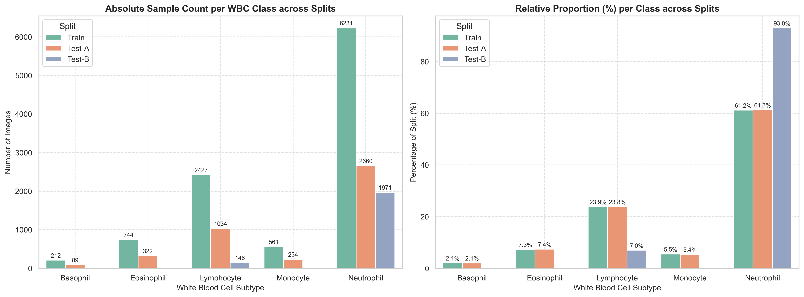
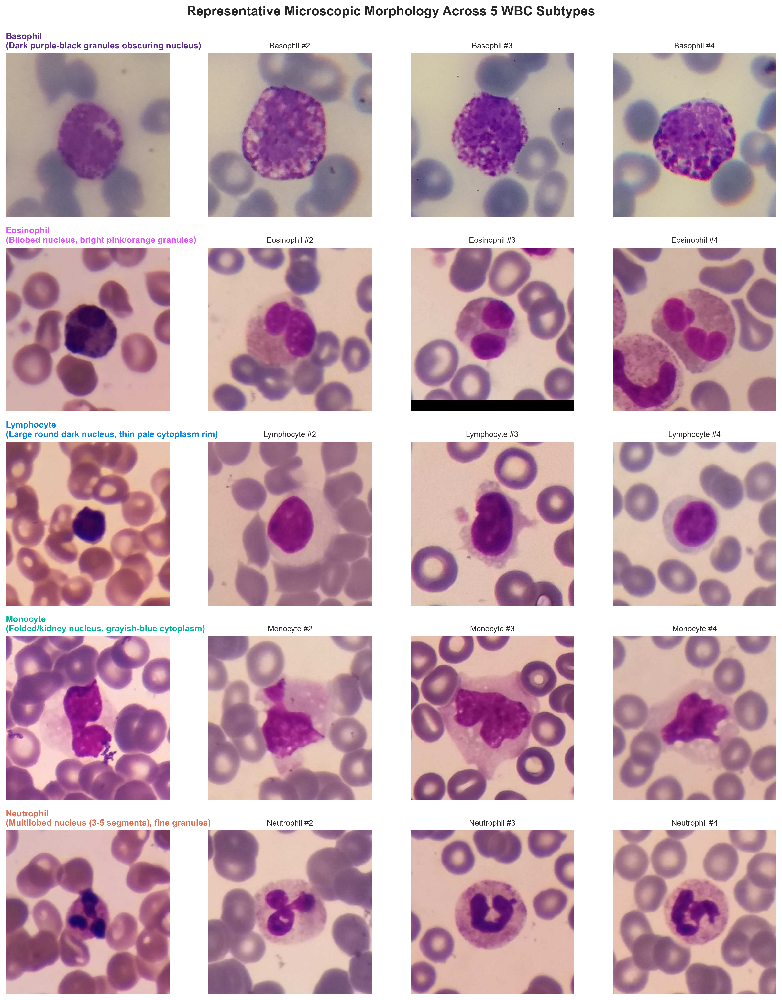
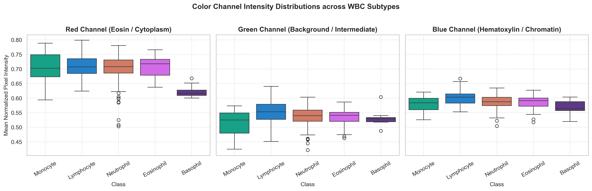
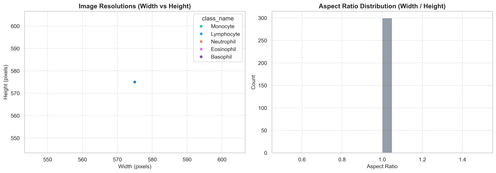

# Exploratory Data Analysis & Dataset Audit Report

**Project:** Peripheral Blood Smear White Blood Cell Classification Using Deep Learning  
**Dataset Source:** Kaggle (Masoud Nickparvar) / Raabin-WBC  
**Total Images Analyzed:** 16,633 images  

---

## 1. Executive Summary & Split Breakdown

The dataset contains peripheral blood smear cropped WBC images organized into three distinct subdirectories:
1. **Train Set (10,175 images):** 5-class training collection used for model learning and cross-validation.
2. **Test-A Set (4,339 images):** The primary held-out 5-class benchmark test set matching the class proportions of the training set.
3. **Test-B Set (2,119 images):** An external generalizability evaluation set containing only Lymphocytes and Neutrophils, collected under alternate camera/stain conditions.

### Split Class Counts & Proportions Table
| WBC Subtype | Train Count (%) | Test-A Count (%) | Test-B Count (%) | Total Verified |
| :--- | :---: | :---: | :---: | :---: |
| **Basophil** | 212 (2.1%) | 89 (2.1%) | 0 (0.0%) | **301** |
| **Eosinophil** | 744 (7.3%) | 322 (7.4%) | 0 (0.0%) | **1,066** |
| **Lymphocyte** | 2,427 (23.9%) | 1,034 (23.8%) | 148 (7.0%) | **3,609** |
| **Monocyte** | 561 (5.5%) | 234 (5.4%) | 0 (0.0%) | **795** |
| **Neutrophil** | 6,231 (61.2%) | 2,660 (61.3%) | 1,971 (93.0%) | **10,862** |
| **Split Total** | **10,175 (100%)** | **4,339 (100%)** | **2,119 (100%)** | **16,633** |

---

## 2. Key Findings & Imbalance Analysis

1. **Severe Natural Class Imbalance:**
   - Neutrophils represent over **61%** of both Train and Test-A sets.
   - Basophils represent only **2.1%** of Train (212 images) and **2.1%** of Test-A (89 images).
   - The imbalance ratio between the majority class (Neutrophil) and the rarest minority class (Basophil) is approximately **29.4 : 1**.
   - *Impact on Modeling:* Standard Cross-Entropy loss will favor the majority class. Evaluating solely by accuracy is invalid; Macro F1-score, balanced recall, and weighted loss are mandatory.

2. **Split Similarity & Leakage Safety:**
   - The relative class proportions between `Train` and `Test-A` match within 0.1% across all 5 classes, confirming that `Test-A` is an unbiased held-out benchmark.
   - Exact filename checks revealed **0 overlapping images** across splits, confirming split independence.

---

## 3. Microscopic Morphology & Staining Observations

- **Basophil:** Distinguished by dense, coarse, intensely dark purple-black granules that cover the cytoplasm and frequently overlay or obscure the nucleus.
- **Eosinophil:** Distinctive bilobed nucleus accompanied by brightly refractive, pink/orange eosinophilic granules filling the cytoplasm.
- **Lymphocyte:** Compact, spherical, dense dark purple chromatin with very high nuclear-to-cytoplasmic (N:C) ratio, leaving only a thin rim of light blue cytoplasm.
- **Monocyte:** Largest mononuclear cell; indented or folded nucleus (kidney bean shaped) with spongy chromatin texture and abundant ground-glass grayish cytoplasm.
- **Neutrophil:** Segmented polymorphonuclear cell possessing 3 to 5 distinct lobes interconnected by fine chromatin threads, with neutral lilac-pink granular cytoplasm.

---

## 4. Image Properties & Preprocessing Decisions

1. **Dimensions:** Native resolutions range primarily between 480x480 and 575x575 pixels. Aspect ratios are closely centered at 1.0 (square crops).
2. **Standardization:** Images will be uniformly resized to **224 x 224 pixels** with bilinear interpolation, matching standard pretrained CNN backbones (MobileNetV2, ResNet50).
3. **Data Augmentation:**
   - Random horizontal & vertical flips ($p=0.5$).
   - Random continuous rotation ($\pm 15^\circ$).
   - Subtle ColorJitter (brightness $\pm 0.1$, contrast $\pm 0.1$) to simulate minor stain exposure differences.
4. **Leakage Prevention:**
   - Augmentations are applied **strictly to the training subset**.
   - Validation and test splits receive **only deterministic resizing and ImageNet normalization**.
