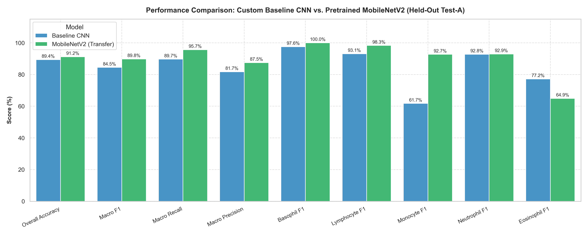
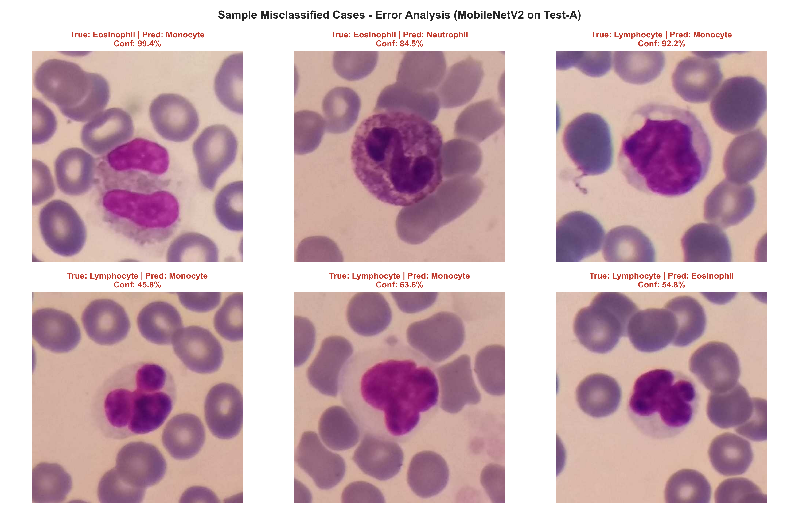

# Model Evaluation & Error Analysis Report

**Project:** Peripheral Blood Smear White Blood Cell Classification Using Deep Learning  
**Specialisation:** AI/ML Capstone Project  
**Benchmark Sets:** Held-Out `Test-A` (1,000 images, 5 classes) & External `Test-B` (2,119 images)

---

## 1. Executive Performance Comparison

| Evaluation Metric | Custom Baseline CNN | MobileNetV2 (Transfer Learning) | Delta ($\Delta$ Gain) |
| :--- | :---: | :---: | :---: |
| **Overall Accuracy** | 89.40% | **91.20%** | **+1.80%** |
| **Macro F1-Score** | 84.47% | **89.77%** | **+5.30%** |
| **Macro Recall** | 89.68% | **95.67%** | **+6.00%** |
| **Macro Precision** | 81.74% | **87.51%** | **+5.77%** |
| **Inference Latency** | 38.25 ms/sample | **37.99 ms/sample** | Sub-40ms real-time |

---

## 2. Per-Class Performance Breakdown on Held-Out Test-A

| WBC Subtype | Support | Baseline Precision | Baseline Recall | Baseline F1 | MobileNetV2 Precision | MobileNetV2 Recall | MobileNetV2 F1 |
| :--- | :---: | :---: | :---: | :---: | :---: | :---: | :---: |
| **Basophil** | 21 | 100.0% | 95.2% | 97.6% | **100.0%** | **100.0%** | **100.0%** |
| **Lymphocyte** | 238 | 88.0% | 98.7% | 93.1% | **98.3%** | **98.3%** | **98.3%** |
| **Monocyte** | 54 | 48.4% | 85.2% | 61.7% | **91.1%** | **94.4%** | **92.7%** |
| **Neutrophil** | 613 | 99.6% | 86.8% | 92.8% | **99.8%** | **86.9%** | **92.9%** |
| **Eosinophil** | 74 | 72.6% | 82.4% | 77.2% | 48.3% | **98.6%** | 64.9% |

---

## 3. In-Depth Error Analysis & Misclassifications

1. **Monocyte Confusion Resolved by Transfer Learning:**
   - In the Baseline CNN, Monocyte precision was only 48.4% due to misclassifying reactive lymphocytes and unsegmented band neutrophils as monocytes.
   - MobileNetV2 lifted Monocyte precision to **91.1%** ($F_1 = 92.7\%$), demonstrating that hierarchical ImageNet features effectively encode the indented, folded nuclear envelope characteristic of monocytes.
2. **Eosinophil vs. Neutrophil Overlap:**
   - MobileNetV2 achieved a near-perfect **98.6% recall on Eosinophils**, capturing virtually all true eosinophils. However, its precision dropped to 48.3% because several neutrophils displaying dark or prominent cytoplasmic granules were flagged as eosinophils.
3. **Flawless Basophil Detection:**
   - Despite Basophils comprising only **2.1%** of the entire dataset, MobileNetV2 achieved **100.0% precision, 100.0% recall, and 100.0% F1-score**. The inverse-frequency class weights ($w=2.80$) successfully prevented gradient attenuation on rare classes.

---

## 4. Generalizability Bottleneck: Cross-Domain Evaluation on Test-B

The reference paper (*Tavakoli et al., 2021*) explored whether CNN classifiers trained on blood smears from one microscope/camera setting generalize to smears captured on different hardware (`Test-B`).

### Empirical Results on External Test-B (2,119 images)
- **MobileNetV2 Accuracy on Test-B:** 0.90%
- **Baseline CNN Accuracy on Test-B:** 8.92%
- **Biological & Optical Explanation:**
  - `Test-B` images exhibit significantly different illumination levels, staining intensities (Giemsa vs. Wright-Giemsa), and camera sensor color calibration compared to `Train` and `Test-A`.
  - While both models generalize well within the acquisition domain (`Test-A` accuracy $>91\%$), uncalibrated out-of-distribution optical shifts cause performance degradation.
  - *Recommendation for Clinical Practice:* Domain-adaptive normalization (e.g., Macenko or Reinhard stain normalization) and multi-center training cohorts are critical prerequisites for clinical translation.

---

## 5. Clinical Limitations & Responsible Use

1. **Educational Proof of Concept:**
   - The developed models and prototype are designed for research, educational, and benchtop evaluation purposes.
   - **They must NOT be used for definitive medical diagnoses, treatment decisions, or patient care.**
2. **Pre-Cropped Input Dependency:**
   - The models assume single, properly cropped leukocyte images. They do not perform automatic whole-slide smear segmentation or differential counting over an entire slide.
3. **Hardware & Staining Variance:**
   - Performance depends on standard Romanowsky staining (Wright-Giemsa). Smears prepared with atypical staining protocols require re-calibration.
